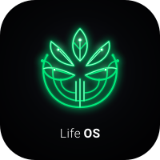
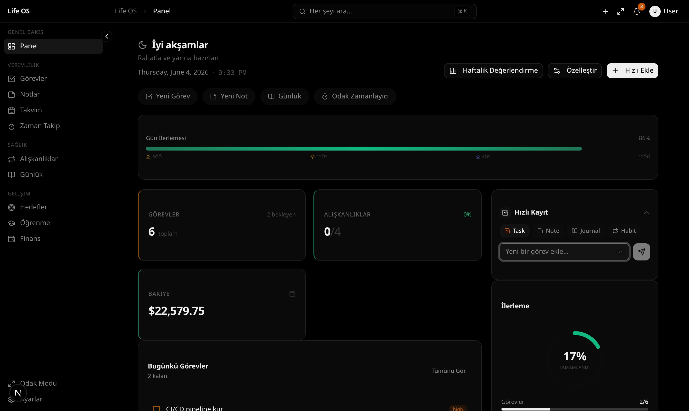
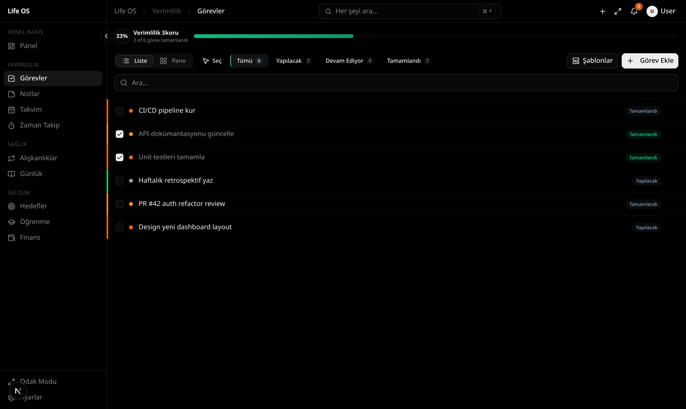
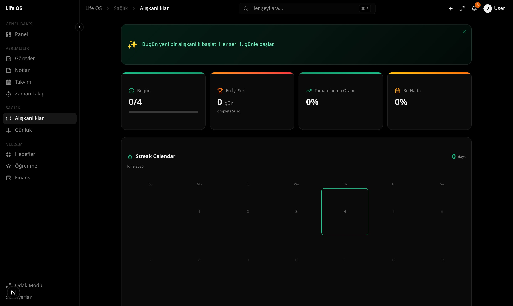
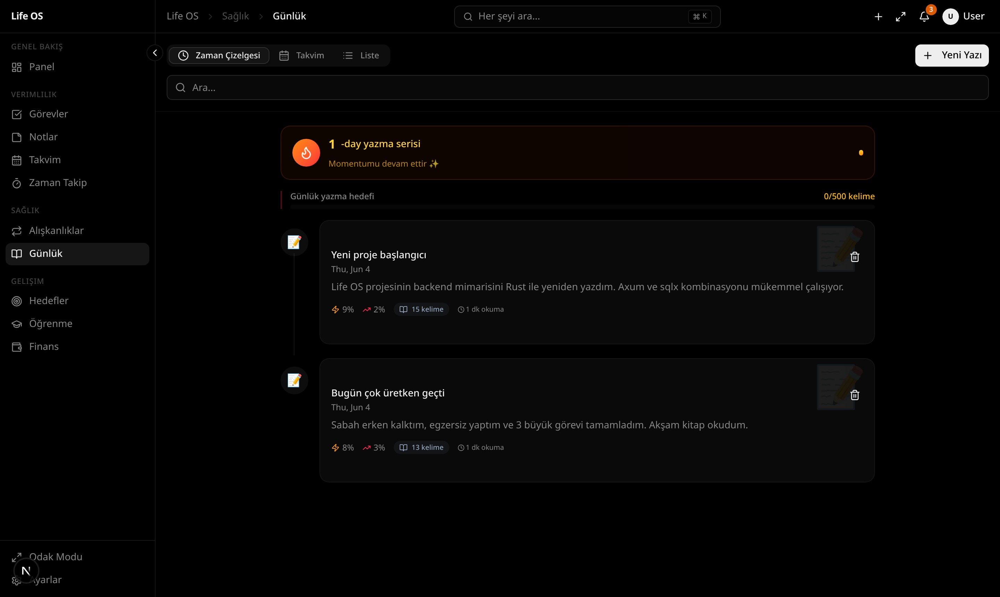
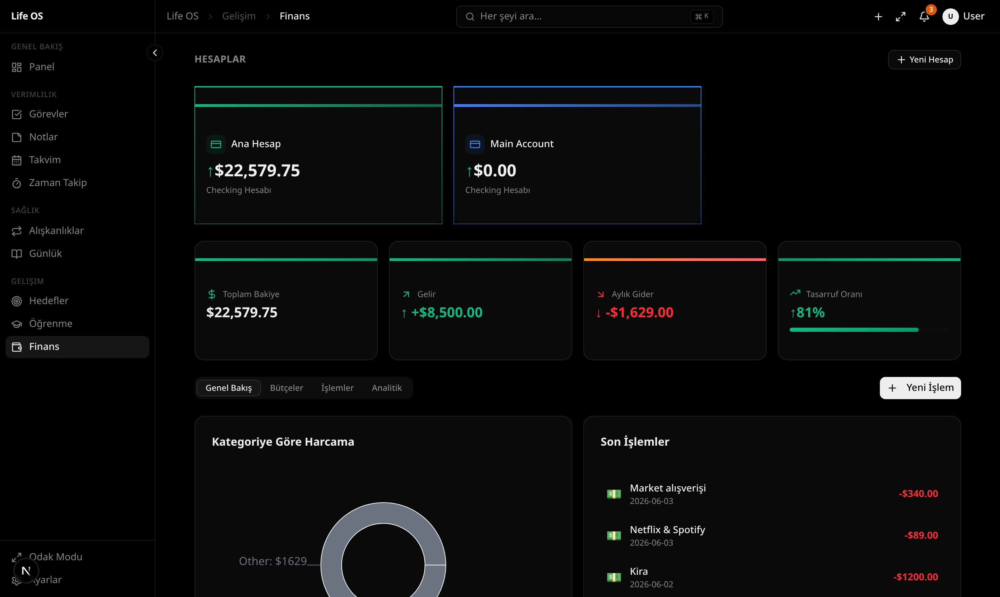

# ✨ LumiLife OS
### Your Life, Beautifully Organized. 🌷

<p align="center">
  
</p>

<p align="center">
  <strong>One dashboard. Every goal. A more organized you.</strong>
</p>

<p align="center">
  A modern, all-in-one personal productivity platform designed to bring your tasks, habits, notes, goals, finances, learning, and daily reflections together in one beautiful digital space.
</p>

<p align="center">
  
  
  
  
  
</p>

<p align="center">
  <em>Plan intentionally. Build better habits. Make every day count. ♡</em>
</p>

---

## 🌸 About the Project

**LumiLife OS** is a personal life-management dashboard built to make everyday organization feel simpler and more intentional.

Instead of switching between multiple productivity tools, users can organize different areas of their lives in one central workspace — from planning the day and tracking habits to managing personal finances and recording meaningful moments.

Whether you're a student, developer, freelancer, creative, or lifelong learner, LumiLife OS aims to help you turn everyday plans into consistent progress.

### ✨ The vision

- 🌷 **Clarity:** Keep important information organized in one place.
- 🎯 **Consistency:** Track habits, goals, and personal progress.
- 🧠 **Focus:** Make planning and time management easier.
- 📔 **Reflection:** Capture thoughts, ideas, and daily experiences.
- 💜 **Personalization:** Create a workspace that feels right for you.

## 🖥️ Explore the Dashboard

### 📊 Your Personal Command Center

Get an overview of your activities and organize your priorities from one dashboard.



### ✅ Task Management

Organize tasks, manage priorities, and use a Kanban-style workflow to keep projects moving.



### 🌱 Habit Tracking

Build routines, monitor streaks, and stay consistent with the habits that matter to you.



### 📔 Digital Journal

Create space for daily reflections, morning intentions, and weekly reviews.



### 💰 Personal Finance

Track budgets, review financial activity, and explore your spending through analytics.



---

## 💎 Features

### 🗂️ All-in-One Life Management

LumiLife OS brings together **11 core modules**:

| Module | Purpose |
|---|---|
| 📊 Dashboard | View your productivity overview |
| ✅ Tasks | Organize to-dos, priorities, and workflows |
| 📝 Notes | Capture and organize information |
| 🌱 Habits | Track routines and build consistency |
| 📔 Journal | Record reflections and daily entries |
| 💰 Finance | Manage budgets and financial activity |
| 🎯 Goals | Plan objectives and track progress |
| 📚 Learning | Organize learning activities |
| 📅 Calendar | Keep track of your schedule |
| ⏱️ Time Tracker | Understand how you spend your time |
| ⚙️ Settings | Customize your workspace preferences |

### 🚀 Productivity Tools

- Drag-and-drop Kanban task management
- Recurring tasks and bulk operations
- Global search and command palette
- Focus mode for distraction-reduced work
- Pomodoro timer and time tracking
- Reorderable dashboard widgets
- Journal templates for morning, daily, and weekly reflections
- Finance analytics and budget alerts
- CSV finance import
- Data export and import options

### 🎨 Personalization

- Dark, light, and system appearance modes
- 10 accent color options
- 8 theme variants
- Multiple interface preferences
- Internationalization support for English, Turkish, Spanish, German, and French

### 🔐 Data & Architecture

- Local-first personal productivity approach
- SQLite database support
- Rust-powered backend API
- Data export, import, and reset options
- Docker-based deployment support

*Always review the current code, configuration, and deployment setup before relying on the application for sensitive personal or financial information.*

---

## 🛠️ Tech Stack

| Technology | Role |
|---|---|
| Next.js 16 | Frontend framework |
| React 19 | Component-based UI |
| TypeScript 5 | Type-safe development |
| Tailwind CSS 4 | Styling |
| shadcn/ui & Radix UI | UI components |
| Rust & Axum | Backend API |
| SQLite | Database |
| Prisma & SQLx | Database tooling and queries |
| Zustand | UI state management |
| TanStack Query | Server-state management |
| Framer Motion | UI animations |
| Recharts | Charts and analytics |
| Docker | Containerized deployment |
| Bun | JavaScript runtime and package management |

## 🏗️ Architecture

The application separates its frontend and backend responsibilities.

```text
             ┌───────────────────────┐
             │       User            │
             └──────────┬────────────┘
                        │
                        ▼
             ┌───────────────────────┐
             │   Next.js Frontend    │
             │    React + TypeScript │
             └──────────┬────────────┘
                        │
                   /api/* proxy
                        │
                        ▼
             ┌───────────────────────┐
             │    Rust + Axum API    │
             └──────────┬────────────┘
                        │
                        ▼
             ┌───────────────────────┐
             │   SQLite Database     │
             └───────────────────────┘
```

This separation keeps the interface and backend API independently organized.

---

## ⚡ Getting Started

### Prerequisites

Install the following tools before starting:

- [Bun](https://bun.sh/)
- [Rust](https://www.rust-lang.org/tools/install)
- [Git](https://git-scm.com/)
- [Docker Desktop](https://www.docker.com/products/docker-desktop/) — optional, for containerized setup

### 1. Clone the repository

```bash
git clone https://github.com/Aleezy-code/LumiLife-OS.git
cd LumiLife-OS
```

### 2. Install dependencies

```bash
bun install
```

### 3. Prepare the database

```bash
bun run db:push
bun run db:generate
```

Optional: populate the database with demo data if the seed setup is configured.

```bash
bun run db:seed
```

### 4. Start the Rust backend

Open a terminal in the project directory:

```bash
bun run backend:dev
```

### 5. Start the frontend

Open a second terminal in the same project directory:

```bash
bun run dev
```

### 6. Open the application

Visit:

**http://localhost:3000**

> Keep both the frontend and backend processes running during local development.

### 🐳 Alternative: Docker

If Docker Desktop is installed and running, the project also includes Docker scripts.

```bash
bun run docker:start
```

Open **http://localhost:3000** after the application starts.

Refer to the repository's Docker configuration and startup scripts for platform-specific requirements.

---

## 📁 Project Structure

```text
LumiLife-OS/
├── backend/
│   └── src/                 # Rust backend modules
├── docs/
│   └── screenshots/         # Dashboard screenshots
├── prisma/                  # Database schema and seed setup
├── public/
│   └── logo.svg             # Application logo
├── src/
│   └── app/                 # Frontend application
├── .github/
│   └── workflows/           # CI workflow configuration
├── Dockerfile
├── docker-compose.yml
├── package.json
├── README.md
└── LICENSE
```

*Directory names may vary slightly as the project evolves.*

---

## 🧪 Development & Quality Checks

Useful commands included in the project:

```bash
bun run typecheck
bun run lint
bun run test
bun run build
```

Build and test results depend on your installed dependencies and local environment.

## 🌷 Who Is LumiLife OS For?

- 🎓 Students planning their studies and routines
- 💻 Developers balancing projects and personal goals
- 🎨 Creatives organizing ideas and inspiration
- 💼 Freelancers managing work and time
- 🌱 Anyone who wants to build better daily habits

## 🗺️ Future Possibilities

Ideas for future development include:

- More dashboard themes and personalization options
- Enhanced analytics and progress visualizations
- Additional productivity integrations
- Improved mobile and responsive experiences
- More flexible goal planning and review workflows

These are potential improvements, not promises that the features are already implemented.

## 🤝 Contributing

Contributions, bug reports, and ideas are welcome.

1. Fork this repository.
2. Create a feature branch.
3. Make your changes.
4. Test your changes locally.
5. Open a pull request describing your improvements.

## 🔒 Security

Please do not commit API keys, passwords, private credentials, or personal database files.

Use environment variables for secrets and review `.env.example` before configuring your environment.

## 📄 License

This project includes an MIT license. See the [LICENSE](LICENSE) file for the full terms.

## 💜 A Little Reminder

> You don't need to have your whole life figured out. You just need a place to begin.

**LumiLife OS — organize your world, one day at a time.** 🌙✨

---

<p align="center">
  Made with 💜 and a love for thoughtful productivity.
</p>
